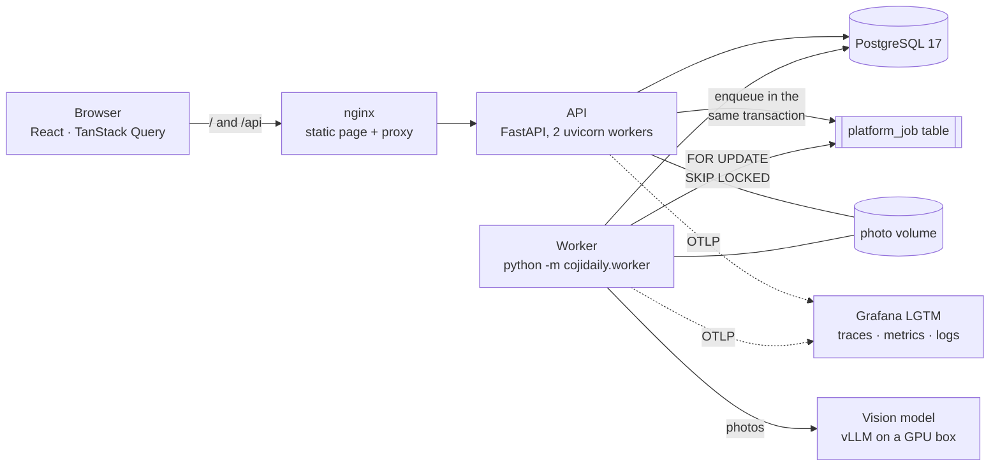
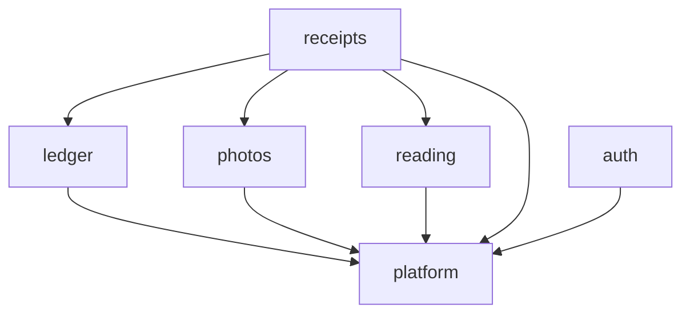

# CojiDaily

**A personal finance agent that understands your spending from the receipts you already have.**

Photograph a receipt; a vision model reads it in the background; if the numbers check out, it posts itself to the ledger, and if not, it waits in an inbox for you. From there the goal is a ledger detailed enough to answer real questions: what a meal actually cost, which card should have paid, where the month went.

I use it every day and am building it toward a hosted version others can sign up for. It is also how I learn full-stack engineering: each step is a complete, working increment, and the questions along the way (why is this page slow? what does async actually buy? what should production observe?) are written up with real measurements.

> This repo is a periodic snapshot of my private working repo, so it may lag behind. Comments in the code sometimes point to `pm/…` design records; those stay private.

## What works today

- **Receipts → ledger, hands-off when it can be.** Upload photos (several photos can form one receipt). A background worker sends them to a self-hosted vision model (Qwen3-VL behind vLLM, OpenAI-compatible API) and runs arithmetic checks on what came back: line items against the subtotal, tax, tip and total. All checks pass, the date isn't in the future and it isn't a likely duplicate → the expense posts itself, marked *unreviewed*. Anything off → it lands in the inbox with the reason.
- **Inbox.** Only what needs me: receipts that couldn't post, and auto-posted expenses to glance at beside their photo. Fix the date or category in place, mark as seen.
- **A calendar that is the entry table.** Week strip with daily totals; the selected day is a spreadsheet-style grid that saves when you leave a cell. Expand an expense to edit its line items; tax, tip and receipt-wide discounts are spread over the lines by largest remainder, so every line has a real cost.
- **Auth done by hand.** Server-side sessions (only a SHA-256 of the token is stored), Argon2id, double-submit CSRF, sessions that end when the password changes.
- **Deployed like a small production system.** Images built once and promoted from *test* to *prod*; a migrate step before the app starts; health checks; scheduled `pg_dump` backups; OpenTelemetry traces and metrics into a Grafana stack with resource limits so it can't starve production.

## Architecture



The backend is a **modular monolith organised by feature**. Each module owns its tables (prefixed with its name) and others may only call its `api.py`:



`platform` has no domain knowledge (settings, database, clock, blob store, background jobs). `reading` knows how to get text out of photos but nothing about receipts; `ledger` knows expenses but nothing about where they came from. That separation is what would let reading or receipts become their own services later, if they ever earn it.

| | |
|---|---|
| Backend | Python 3.13, FastAPI, SQLAlchemy 2, psycopg 3, Alembic, PostgreSQL 17 |
| Frontend | React 19, TypeScript, Vite, TanStack Query, React Router, Tailwind + Radix (shadcn/ui-style) |
| Jobs | A hand-written job table polled by a worker: no Redis or Celery to run |
| Model | Qwen3-VL served by vLLM on a separate GPU machine, called over HTTP |
| Ops | Docker Compose, nginx, OpenTelemetry → Grafana LGTM |
| Tests | pytest against real PostgreSQL; Vitest + jsdom |

More detail: [server/README.md](server/README.md), [web/README.md](web/README.md), [deploy/README.md](deploy/README.md).

## What I learned along the way

The first version was Django + MySQL. Before rebuilding, I measured instead of guessing:

- **[Django vs FastAPI under load](learning/fastapi-vs-django-report.md)**: three runs of the same two k6 tests. For ordinary pages FastAPI was modestly faster; for minute-long model calls the framework barely mattered and *sync vs async* decided everything.
- **[Load testing](learning/load-testing.md)**: what load testing is (concurrency, not data size), and what broke first.
- **[Observability](learning/observability.md)**: spans, auto-instrumentation, and why the code barely changes.
- **[Waterfalls](learning/waterfalls.md)** (in Chinese): turning measured timings into DevTools-style waterfall charts to *see* where a page's time goes.

## Where it's heading

Some of these already ran in the first (Django) version and are waiting to be ported; the rest are being designed.

- **A hosted version for everyone.** Sign-up, per-account data isolation (user data is already scoped by `owner_id`), HTTPS, rate limiting, and a reading service that doesn't depend on my home GPU.
- **Ask the ledger.** A read-only MCP server over the API, so Claude or another agent can answer "what did I spend on groceries this month?" (prototyped on the first version).
- **Groceries as inventory.** Track what's bought, used and wasted per batch; cooking turns ingredients into a new batch, so a meal has a cost (built in the first version).
- **More than receipts.** Expenses from card statements, emails and texts, not just paper.
- **Card rewards.** Which card to use where, as structured rules (rates, caps, periods, merchant categories) plus a deterministic calculation, rather than a chatbot guessing.
- **Comparing reading services.** The first version compared vLLM, AWS Textract and Google Document AI on the same receipt; the rebuild has one provider behind a setting, with room for more.
- **Splitting services**, once the module boundaries above have proven themselves.

Today's limits, which the hosted version has to close: accounts are created from the command line; it runs on a home network (no login rate limiting, plain HTTP on the LAN); a misread date can still auto-post because no arithmetic check can catch it.

## Running it locally

Needs Docker, [uv](https://docs.astral.sh/uv/) and Node.

```bash
server/dev.sh cli createuser demo   # PostgreSQL in Docker, migrate, then make an account
server/dev.sh run                   # API on 127.0.0.1:8000, reloading on edits, plus the worker
cd web && npm install && npm run dev
```

Open `http://localhost:5173`. Reading receipts needs an OpenAI-compatible vision model; set `VLLM_*` in `server/.env`. Without it, everything else works and readings fail with a clear error.

```bash
server/dev.sh test        # backend tests
cd web && npm test        # frontend tests
```

## License

[AGPL-3.0](LICENSE). You may read, run and modify it; if you offer a modified version as a service, you must publish your changes under the same license.
