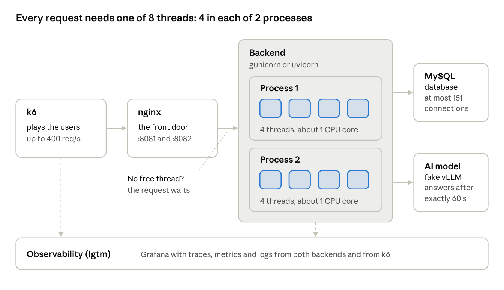
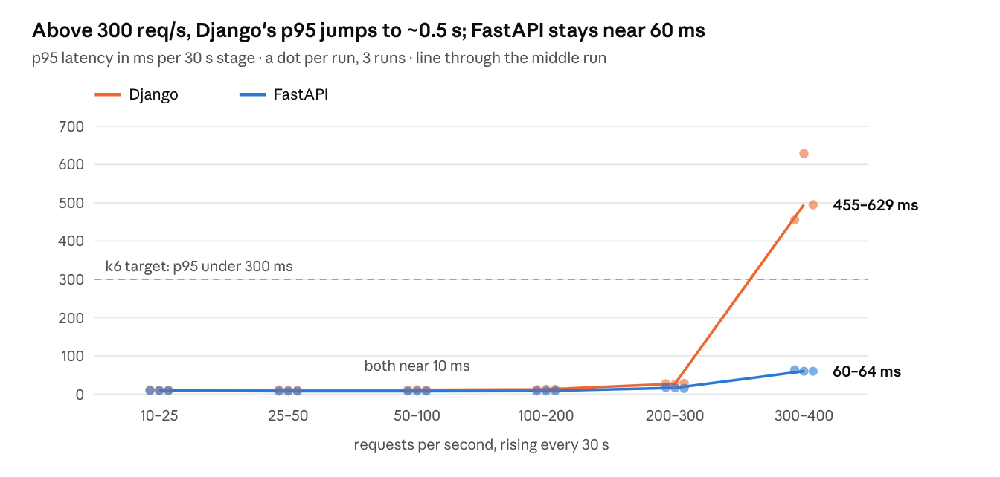
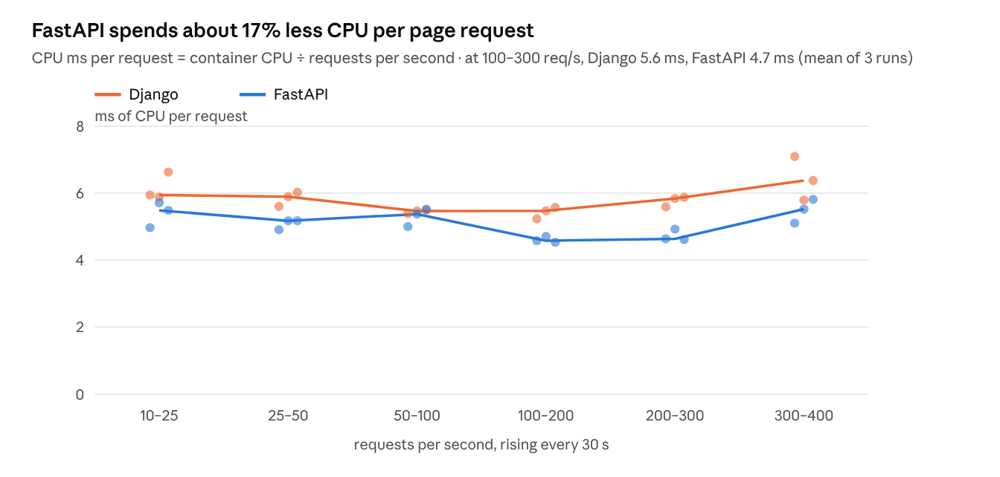
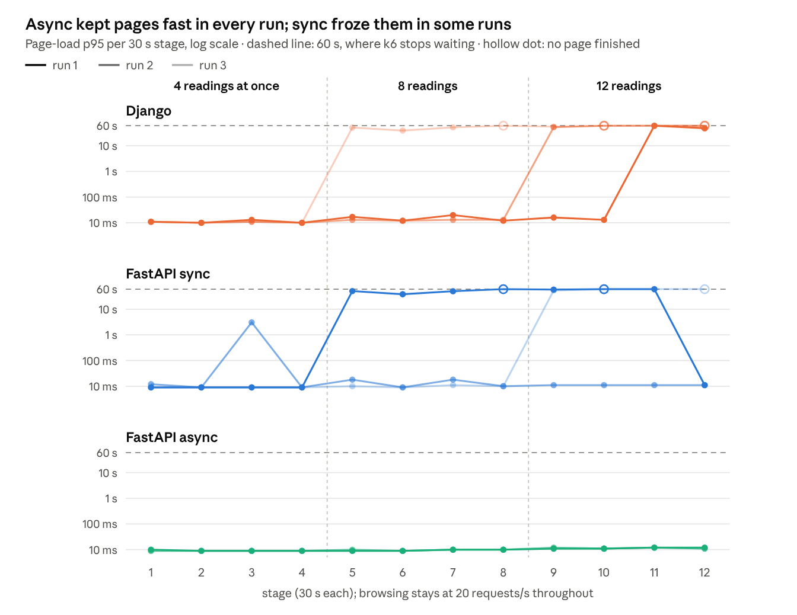
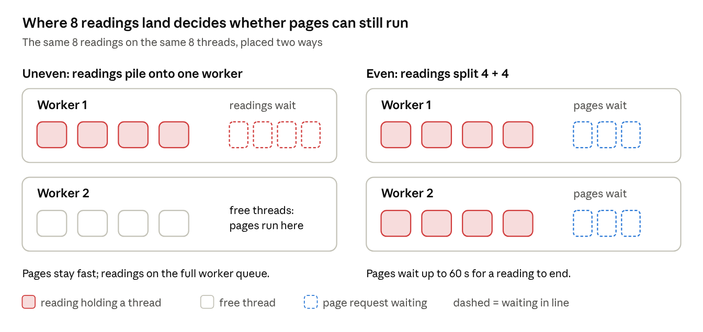
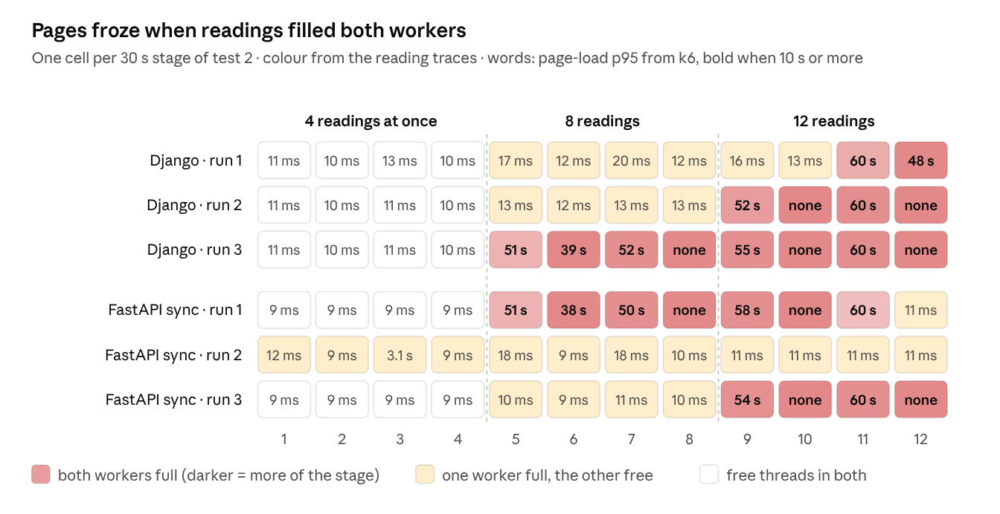
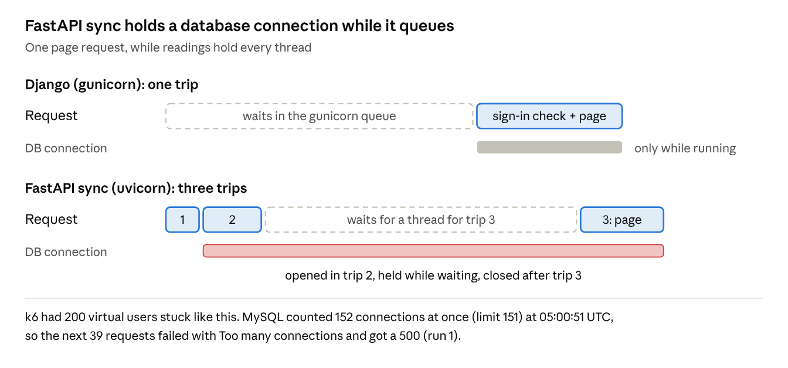
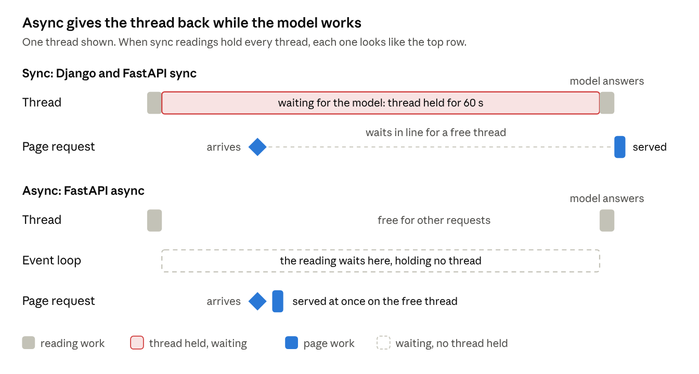

# Django vs FastAPI under load

Written 2026-10-21, after three runs on the 4060 PC. This is the export of the shared doc [Django vs FastAPI under load](https://claude.ai/artifact/CKcW3yWCjGLcmrRGBQiU6N), where the charts are interactive; here they are images. The per-run tables and the run-1 working notes are in `learning/fastapi-vs-django.md`.

## Summary

For ordinary pages, FastAPI is a little faster than Django. For receipt readings that wait a minute on the AI model, the framework hardly matters; what decides everything is whether the reading waits *sync* or *async*. Django, FastAPI sync and FastAPI async were each run through the same two load tests three times on the 4060 PC.

- **Pages (test 1):** both answer in about 10 ms up to 300 requests/s. At 300–400 requests/s Django's p95 rose to 455–629 ms, FastAPI's to 60–64 ms. FastAPI uses about 17% less CPU per request (4.7 vs 5.6 ms), so Django runs out of CPU at a lower request rate.
- **Sync readings (test 2):** once readings tie up both worker processes' threads, every page waits for up to a minute, on both frameworks. Whether that happened at 8 readings changed from run to run, depending on how readings landed on the two processes; at 12 readings it happened in 5 of 6 runs.
- **An extra failure in FastAPI sync:** requests waiting for a thread kept a database connection open. In one run MySQL hit its limit of 151 and 39 page requests failed.
- **Async readings:** in all three runs, pages stayed at 9–12 ms with 12 readings at once, every reading took exactly the model's 60 s, nothing failed, and 48 readings were answered against 29–40 for sync.

So you heard right: async makes a lot of difference, though only for requests that wait on something slow. Sections 2 and 3 explain the terms and the setup for readers new to them.

## 1. The question

Does the web framework change how the app behaves when many requests arrive at once? Django runs the app today. FastAPI is a rewrite of the same API, built only to answer this.

Your words when the port started:

> "I can run the tests ran with Django to see some difference although it would be pretty much the same I think. Unless the way Django handles multiple workers and async is different from fastapi. But I also heard that setting async in fastapi will make it a lot different, and should probably just use sync def ? Or maybe we can have both ?"

So three backends were tested. They give the same answers to every request (92 contract tests check that) and read the same database tables. What differs is the server program and how a receipt reading waits for the AI model:

| Backend | Server program | Processes × threads | While a reading waits for the model |
| --- | --- | --- | --- |
| Django | gunicorn | 2 × 4 | its thread is blocked for the whole wait |
| FastAPI sync | uvicorn | 2 × 4 | its thread is blocked for the whole wait |
| FastAPI async | uvicorn | 2 × 4 | the thread is handed back; the reading resumes when the answer arrives |

**What a reading is.** You upload a receipt photo and press read. The backend sends the photo to the vision model on the Spark and waits for its answer, which takes 30–90 s in real use. In these tests a stand-in model answers after exactly 60 s, with a real saved answer, so every run waits the same amount.

**Sync and async, in one line each.** Sync code waits by standing still: the thread running it can do nothing else until the answer comes. Async code waits by stepping aside: the thread serves other requests meanwhile. Section 2 explains threads.

## 2. A beginner's map

*the PC's test stack as set up for these tests · same layout for both backends*

A request travels left to right. k6 sends it, nginx passes it to the backend, and the backend needs a free thread to run it. Most requests read MySQL; a reading also calls the AI model and waits 60 s for it.

The ideas the rest of the report uses:

- **Process.** A running copy of the backend program. Each backend runs 2, so both get the same resources.
- **Thread.** A worker inside a process that handles one request at a time. 4 per process, so 8 requests can run at once.
- **GIL (global interpreter lock).** Python runs only one thread's code at a time in a process. So each process uses about one CPU core, whatever its thread count. Extra threads help with waiting, not with computing.
- **Queue.** When all 4 threads of a process are busy, a new request waits in line. Waiting is not working: the server can sit idle while users wait.
- **Thread pool (FastAPI).** The 4 threads that run FastAPI's `def` code. A loop in each process takes requests in and hands each step to the pool.
- **Event loop (async).** That same loop runs `async def` code itself. At a wait, async code steps aside so the loop can serve other requests.
- **Latency and p95.** Latency is how long one request takes, as k6 measures it. p95 is the time 95% of requests beat: it shows what the slowest few feel, which an average hides.
- **Requests per second, dropped.** k6 starts requests at a set rate. Dropped means k6 had to skip a request because all its virtual users were stuck waiting.
- **Trace and span.** A trace is the timeline of one request; each step inside it, such as a database query or the model call, is a span.

## 3. How the test was set up

Everything that could favour one backend was held the same, so a difference in the results comes from the framework or the waiting style.

| Held the same | How |
| --- | --- |
| Machine | The 4060 PC: 12 CPU cores, 15 GiB. k6 runs on the same PC, so Wi-Fi is not in the numbers. |
| Front door | The same nginx image and settings in front of each backend. |
| Resources | 2 processes × 4 threads each. One new MySQL connection per request, closed when it ends. |
| Data | A copy of the real ledger from 16 Oct. Each backend gets its own identical copy, and FastAPI's is re-made before each of its readings tests. |
| Model | A stand-in that waits exactly 60 s, then returns a real saved answer. No GPU is used. |
| Measuring | Both traced the same way (OpenTelemetry into Grafana). CPU sampled per container every \~5 s. |

The live app on :8080 kept running untouched throughout.

### Test 1: browsing

*How many page requests per second can it take, and what runs out first?* k6 asks for read-only pages (calendar, receipt review, reading results, the receipt album) at a rate that climbs every 30 s: 10 → 25 → 50 → 100 → 200 → 300 → 400 requests/s. Each 30 s step is a **stage**: 6 stages, 3 minutes.

### Test 2: readings and browsing at once

*What does a slow model do to everyone else?* For 6 minutes k6 browses at a steady 20 requests/s, like a few busy users. Meanwhile 4, then 8, then 12 virtual users each start a reading, wait for it, and start the next. Each level lasts 2 minutes, so 12 stages in all.

Why 4, 8 and 12: each backend has 8 threads. With 4 readings half the threads stay free; with 8, readings can hold all of them; with 12 there are more readings than threads.

### Runs

One run is the whole sequence, about 35 minutes, unattended (`perf/load/compare.sh`):

1. Reset the test stack from the snapshot.
2. Test 1 on Django, then on FastAPI.
3. Test 2 on Django, then on FastAPI sync.
4. Switch FastAPI to async (only FastAPI's container and data are re-made).
5. Test 2 on FastAPI async.

Run 1 started 21 Oct at 00:36; runs 2 (01:31) and 3 (02:11) repeated it exactly, to see whether the results hold or depend on luck. Test 1 isn't repeated for async: browsing never reaches the reading code, so it is the same code as FastAPI sync.

## 4. Test 1 results: browsing up to 400 requests/s

Neither backend returned a single error, and both answered in about 10 ms up to 300 requests/s. Above that, Django slowed sharply in all three runs while FastAPI stayed fast.

*k6 summaries of test 1 · runs 1–3, 21 Oct 2026, on the PC*

In the last stage Django also had to skip 152–204 requests: k6 ran out of virtual users, because so many were still waiting for answers. FastAPI skipped none and never needed more than its first 50 virtual users.

### What ran out: CPU

*docker stats every \~5 s, mean per stage ÷ requests started in that stage · runs 1–3*

Each Python process can use about one CPU core (the GIL, section 2), so two processes give about 2,000 ms of CPU per second. Dividing by the CPU each request costs gives a rough ceiling *(inferred)*:

- Django: 2,000 ÷ 5.6 ms ≈ **360 requests/s**
- FastAPI: 2,000 ÷ 4.7 ms ≈ **430 requests/s**

That is why Django's slowdown lands inside the last stage (300 → 400) and FastAPI's just beyond it. It matches the 17 Oct finding that Django's two processes, not MySQL or nginx, run out first.

Where FastAPI's saving comes from wasn't measured. Likely candidates are Django's chain of middleware and request objects, and its JSON escaping, which makes answers longer. For one person using the app, it doesn't matter: a few requests per second is about 100 times below either ceiling.

## 5. Test 2 results: readings and browsing at once

Async kept page loads at about 10 ms in every run, even with 12 readings at once. With sync readings, both frameworks froze page loads for up to a minute at a time, and *when* they froze changed from run to run.

*k6 summaries of test 2 · runs 1–3, 21 Oct 2026, on the PC*

**How to read it.** Each panel is one backend; each line is one run. A line near the bottom (about 10 ms) means pages were fast. A line at the dashed 60 s line, or a hollow dot, means page requests were stuck behind readings for up to a minute. The scale is logarithmic, so each gridline is 10 times the one below.

- **FastAPI async** (bottom) never left 9–12 ms in any stage of any run.
- **Django** froze at 8 readings in run 3, and at 12 readings in all three runs.
- **FastAPI sync** froze at 8 readings in run 1, and at 12 readings in runs 1 and 3. In run 2 it never froze; its worst stage was a 3 s p95 at only 4 readings (section 6 explains why).

Why the runs differ is section 6. Totals per run:

| Backend | Run | Page requests that failed | Requests k6 couldn't start | Readings answered | Longest reading |
| --- | --- | --- | --- | --- | --- |
| Django | 1 | 41 | 736 | 37 | 120 s |
| Django | 2 | 27 | 1,698 | 35 | 119 s |
| Django | 3 | 11 | 3,200 | 40 | 114 s |
| FastAPI sync | 1 | 118 | 2,511 | 39 | 114 s |
| FastAPI sync | 2 | 33 | 0 | 29 | 124 s |
| FastAPI sync | 3 | 26 | 1,687 | 38 | 109 s |
| FastAPI async | 1 | 0 | 0 | 48 | 60 s |
| FastAPI async | 2 | 0 | 0 | 48 | 60 s |
| FastAPI async | 3 | 0 | 0 | 48 | 60 s |

- **Failed** is mostly page requests that hit k6's 60 s timeout. FastAPI sync's run 1 also includes the 39 errors and 2 broken readings of section 7.
- **Couldn't start**: k6 keeps at most 200 virtual users. When all of them are stuck waiting, it skips new page requests.
- **Readings answered** counts the readings nginx answered with success. Async answers more because no reading waits for a thread first.
- **Longest reading**: the model takes 60 s, so anything above 60 s is time spent waiting for a free thread.

## 6. Why sync freezes, and why not every time

With sync readings, pages freeze when **both** worker processes have all 4 threads held by readings. Which worker each reading lands on is not up to the app, and it changed from run to run.

*schematic · 2 worker processes × 4 threads, as in every backend tested*

**What the traces show.** Each reading's trace says which worker ran it and when, so it's possible to reconstruct, moment by moment, how many threads each worker had tied up. Lining that up with page-load times:

*worker saturation from every reading trace in Tempo (sampled every 100 ms) · p95 from k6 · runs 1–3*

Every stage where pages froze (bold: p95 of 10 s or more, or no page finished) had both workers full for much of it. Every fast stage had at least one worker with a free thread. The one middle case is FastAPI sync's run 2: all its readings piled onto one worker, even at 4 readings. Pages that happened to land on that worker waited, which lifted stage 3's p95 to 3 s; the rest ran on the free worker.

So the frameworks behave alike here. Over three runs, Django froze at 8 readings once and FastAPI sync once; at 12 readings Django froze in all three runs and FastAPI sync in two. On 17 Oct, Django also froze at 8.

**Why placement varies.** Most likely (inferred, not measured): nginx opens connections to the backend, and the operating system decides which of the two worker processes accepts each one. A busy sync worker still accepts new connections, because the waiting happens in its threads, not in its accept loop. So readings can pile onto one worker, or split evenly; nothing in the app steers it.

**What that means.** With 8 readings on 8 threads, a sync backend is on the edge: an uneven split leaves a worker free for pages, an even split freezes everything. More threads only move the edge. Async removes it, because a waiting reading holds no thread at all.

## 7. A failure only FastAPI sync had

In run 1, 39 page requests failed in the same second with a 500 error. The database had run out of connections, and only FastAPI sync made that happen.

*schematic, not to scale · numbers from run 1's nginx log, Tempo and MySQL's counters*

**What happened.** FastAPI runs a `def` endpoint as several separate trips to the thread pool:

1. Open a database session.
2. Check the sign-in. This runs a query, so a MySQL connection opens and stays open.
3. Run the page itself.

With readings holding every thread, a request finished trip 2 and then queued for trip 3, still holding its connection. Waiting requests piled up connections until MySQL refused new ones.

**Why not Django.** Django runs a request on one thread from start to finish. A request waiting in gunicorn's queue hasn't touched the database yet, so waiting costs no connection.

**Evidence from run 1:**

- nginx's log: 39 answers of 500 at 05:00:51 UTC, each after about 50 s of waiting. Two readings got a 502 in the same second; their cause wasn't found.
- Tempo: all 39 error traces carry `(1040, 'Too many connections')` from MySQL.
- MySQL's own counters: limit 151, 152 used at 05:00:51, 39 connection errors.

**Why it matters.** A slow page became a failed page. Anything else using that MySQL server at that moment, Django included, would have been refused a connection too. The live app has its own MySQL server and wasn't affected. Section 9 shows whether it happened again in runs 2 and 3.

It is not fixed here, because the port was kept identical to Django for the comparison. Candidate fixes are listed in the issue `fastapi-sync-holds-db-connections`; the simplest is to do the sign-in check inside the page's own trip.

## 8. Why async doesn't freeze

Async stops a waiting reading from holding a thread, and that is the whole difference.

*schematic, not to scale · one reading and one page request on one thread*

**Sync.** The reading keeps its thread for the model's whole 60 s while doing nothing. A backend has only 8 threads, so 8 readings hold all of them, and a page request has nowhere to run until a reading ends.

**Async.** The reading's wait is parked on the event loop, which can hold many waits at almost no cost. A thread is busy only for the short steps: preparing the photo and saving the result. Between them it serves pages.

The change is small. FastAPI async differs from FastAPI sync only in the reading endpoint: `async def` plus an HTTP client that can wait without blocking. Every other endpoint is the same code.

## 9. Did the results hold across three runs?

The findings that matter held in every run. The only thing that changed was *when* the sync backends froze, which is the placement effect of section 6.

| What was checked | Run 1 (00:36) | Run 2 (01:31) | Run 3 (02:11) |
| --- | --- | --- | --- |
| Page p95 at 300–400 req/s, Django vs FastAPI | 455 vs 64 ms | 629 vs 60 ms | 495 vs 60 ms |
| Django: pages froze at 8 readings | no | no | yes |
| Django: pages froze at 12 readings | yes | yes | yes |
| FastAPI sync: pages froze at 8 readings | yes | no | no |
| FastAPI sync: pages froze at 12 readings | yes | no | yes |
| FastAPI sync: most MySQL connections at once (limit 151) | 152, 39 refused | 35 | 130 |
| FastAPI async: pages froze | no | no | no |
| Readings answered: Django / FastAPI sync / FastAPI async | 37 / 39 / 48 | 35 / 29 / 48 | 40 / 38 / 48 |

**Steady in every run:**

- FastAPI's lower CPU per page, and with it a 7–10× lower p95 at 300–400 req/s.
- Async: no freezes, no errors, every reading 60 s, 48 answered.
- Sync froze pages whenever readings filled both workers, in both frameworks.

**Changed from run to run:**

- Whether 8 readings filled both workers. Each sync backend froze at 8 in one run of three; Django also froze at 8 on 17 Oct. Both placements showed up in both frameworks, so there is no sign that one framework places readings better.
- How many connections FastAPI sync piled up. It tracks how long it stayed frozen: 152 in run 1 (frozen from 8 readings), 130 in run 3 (frozen at 12), 35 in run 2 (never frozen). Django's waiting doesn't hold connections: in run 2 it froze at 12 readings, yet MySQL never saw more than 35 at once in the whole run.

Three runs show that placement varies; they are too few to say how often each placement happens.

## 10. What the monitoring saw, and what it missed

The same queue looks different from each place you can measure. FastAPI's traces show the wait for a thread; Django's traces start after it, so a frozen Django looks healthy from the inside.

Time from a reading's trace starting to the reading's own work starting, over every reading in run 1:

| Backend | Median | Longest | Readings |
| --- | --- | --- | --- |
| Django | 1.7 ms | 2.1 ms | 40 |
| FastAPI sync | 25.5 ms | 53.6 s | 40 |
| FastAPI async | 1.9 ms | 14.7 ms | 48 |

Django's 2.1 ms is not because nothing waited. k6 saw Django readings take up to 2 minutes, but the minute spent in gunicorn's queue happens before Django starts its trace. FastAPI starts its trace on the event loop, before the wait for a pool thread, so the 53.6 s shows up. Runs 2 and 3 agree: FastAPI sync's longest waits were 64.2 s and 49.2 s, while Django's stayed under 3 ms and async's under 6 ms.

| Where you look | Does it see requests stuck in the queue? |
| --- | --- |
| k6, the client | Yes: it times the whole request. |
| nginx's log | Yes: it records how long the backend took to answer. |
| Django's traces | No: they start after the queue. |
| FastAPI's traces | Yes: a gap before the work starts. |
| CPU per container | Misleading: FastAPI sync sat at 0.2% CPU while users waited up to 60 s. |
| Loki, FastAPI's logs | Missed the 39 failures: uvicorn's own error log isn't sent to Loki. |

The lesson from 17 Oct holds: measure from outside the app too. A queue is invisible to the code waiting behind it.

## 11. What it means, what's next, and the limits

**For CojiDaily, the framework matters little and the waiting style matters a lot.** One person makes a few page requests per second, about 100 times below either backend's ceiling in test 1. The real risk is readings: with sync waiting, 8–12 readings at once can freeze every page for up to a minute, on Django and FastAPI alike. You'd reach that by reading a batch of receipts at once, not by browsing.

What the results suggest, as options rather than decisions:

1. **Keep the reading endpoint async** if the backend moves to FastAPI. It's already written and passed every test here.
2. **Fix FastAPI sync's connection holding** before running it anywhere real: do the sign-in check inside the page's own trip (issue `fastapi-sync-holds-db-connections`).
3. **Consider readings as background jobs** later: answer "reading started" at once and let the page ask "done yet?". That also frees nginx's and the browser's connection during the 60 s, which async alone doesn't.
4. **Measure the queue Django hides**: nginx can stamp each request with the time it arrived, so the backend can report how long it waited before starting.

**Limits of this test:**

- Three runs per setup. They show the placement effect but can't say how often each placement happens.
- A stand-in model with a fixed 60 s. Real readings vary from 30 to 90 s and use the Spark's GPU, which was never touched.
- One machine, with k6, both backends, MySQL and the monitoring sharing its 12 cores.
- p95 per 30 s stage comes from k6's own summary; CPU from samples every \~5 s (5–7 per stage).
- Threads held per worker are reconstructed from the reading traces. That works for the sync backends only, since an async reading holds no thread while it waits.

**Where everything is.** The raw data for each run is on the PC in `~/CojiDaily-testdata/comparison*`: k6 output, nginx logs, CPU samples, traces, MySQL counters. To rerun the whole comparison, use `perf/load/compare.sh`; the analysis scripts sit next to it. `learning/fastapi-vs-django.md` holds the run-1 technical notes. Terms are explained in section 2.
